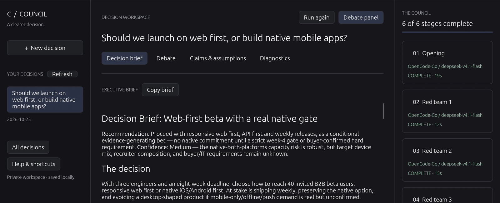
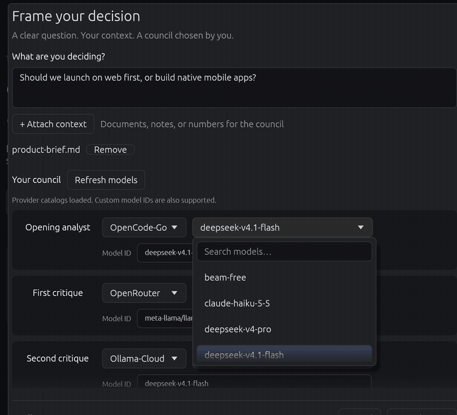

# Adversarial Council

**Turn a difficult choice into a decision brief.**

Ask a question, add your context, and choose the AI models you want to hear from. Council builds an opening case, challenges it through three critiques, revisits the recommendation, and brings the debate into a brief with tradeoffs, risks, and next steps.



*A real model run using a fictional product launch scenario. The screenshot is cropped to the recommendation; the full debate is saved with it.*

## What you can do

- **Compare perspectives:** choose a provider and model for every role, or use the same model throughout.
- **Bring your own context:** attach notes, numbers, and documents before starting.
- **Read the result:** inspect the arguments, review claims and assumptions, and copy the final brief.
- **Revisit a decision:** reopen saved sessions from the sidebar.

Council supports **Mistral, OpenRouter, Ollama Cloud, and OpenCode Go**. You only need accounts for the providers you choose.

## Try it without an API key

The app currently runs from source. Install [Git](https://git-scm.com/downloads) and [Rust](https://rustup.rs/), then open a terminal and run:

```bash
git clone https://github.com/nicolas-found42/adversaries.git
cd adversaries
cargo run -- --demo
```

The first build can take a few minutes. A desktop window opens with a simulated debate so you can explore the brief and other views without API charges. The demo uses sample responses; it does not call a model.

## Run your first real decision

1. Install [uv](https://docs.astral.sh/uv/getting-started/installation/), which manages Python and the backend dependencies. From the same project folder, run:

   ```bash
   uv sync --all-extras
   ```

2. Copy the included settings template:

   ```bash
   cp .env.example .env
   ```

   On Windows PowerShell, use `Copy-Item .env.example .env`. Open `.env` in a text editor and add an API key for at least one provider. The template names each key; leave unused providers blank. Keep your keys private. See [provider setup](docs/configuration.md) for details.

3. Close the demo and open the live app:

   ```bash
   cargo run
   ```

4. Click **New decision**. Write a question with clear alternatives, such as:

   > Should we launch a responsive web app first, or build native mobile apps? We have three engineers and eight weeks.

5. Attach any relevant context. In **Your council**, choose a configured provider and model for **each role**. If you have one provider account, use it for all six roles. Keep **Debate rounds** at **1** for your first run.

6. Check the displayed call count and click **Start decision**. Read completed stages while the council works, then open **Decision brief** when it is ready. Use **Copy brief** to take the result elsewhere.



*Each role has its own provider and model selection. This recording is sped up.*

One round uses **six model calls**. Live runs use your provider accounts; cost and waiting time depend on your models, context, and their reasoning. **Dry run** in the composer lets you try the workflow without paid inference.

## Get a useful answer

Include your deadline, constraints, known facts, and what you still need to learn. For example, attach a short brief with your team size, budget, options, and success criteria. Read the critiques and unresolved disagreements alongside the recommendation.

Sessions are saved in `reports/` on your computer. Live calls send your question, attachments, and debate context to the providers you select. Claim labels describe the model's argument; they do not independently verify facts. Check important evidence before acting.

## Learn more

- [Using Council](docs/usage.md) — rounds, history, recovery, shortcuts, and claim labels.
- [Provider setup](docs/configuration.md) — API keys, default models, and saved files.
- [Command-line guide](docs/cli.md) — run without the desktop interface.
- [Development](docs/development.md) — browser live reload, architecture, and quality checks.
- [All documentation](docs/README.md) — diagnostics, research, and project conventions.
