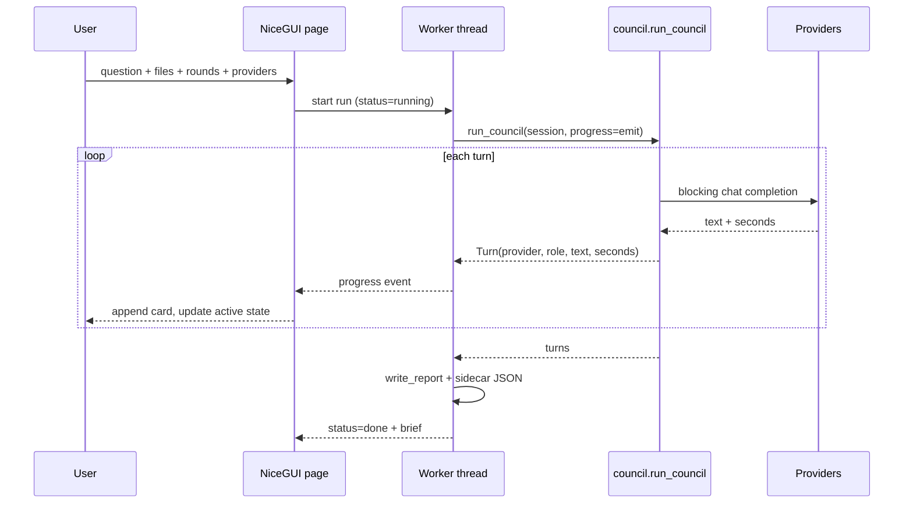

# UI research: what to build for Adversarial Council

**Date:** 2026-10-23
**Scope:** similar projects on GitHub, awesome-list coverage, and the UI stack decision for this repo.
**Method:** GitHub REST/search via `gh` (stars-sorted queries and topic searches), README/source inspection of each shortlisted project, primary framework docs, a CORS preflight probe of the four providers, and TypeSafe Jev judgments for classification, ranking, and decisions. No subagents were used.

The repo has no research-notes directory yet; this file starts `docs/research/` as the convention.

---

## Bottom line

1. **The closest architectural reference is [`karpathy/llm-council`](https://github.com/karpathy/llm-council)**: FastAPI + React, one conversation sidebar, three stages, and Server-Sent Events for stage progress. It has **no license file**, so borrow the shape, not the code.
2. **The closest feature-complete reference is [`appleweiping/WEIPING_COUNCIL`](https://github.com/appleweiping/WEIPING_COUNCIL)** (MIT): six protocols, per-call traces, confidence, dissent, degraded-state warnings, session history, and a demo mode.
3. **The best disagreement UX is in [`albertofettucini/Council`](https://github.com/albertofettucini/Council)**: a 0–100 divergence score with camps and an outlier, a separate dissent spotlight, and a decision journal.
4. **No public project implements this repo's exact protocol** — each model attacks the most recent output, the lead rebuts, then a brief is written — nor a claim-level ledger across turns. Jev's `find` returned `exists: 0.69` (`partial`), and the best candidates scored only 0.33/0.31/0.17. That is the differentiation opportunity.
5. **Recommended stack:** a local **NiceGUI** UI behind an optional `ui` dependency, with the debate timeline on the left and the Decision Brief pinned on the right. Jev selected NiceGUI with probability **0.56** (decision confidence 0.51; runner-up FastAPI + static page at 0.23). If the design turns into a highly bespoke claim graph with custom interactions, switch to FastAPI + a hand-written static client.
6. **Do not build a zero-backend PWA.** Only two of the four providers returned CORS headers in a preflight probe; browser-only calls cannot reach Ollama Cloud or OpenCode Go.
7. **Persist history as a JSON sidecar** next to each Markdown report. Jev: 1.00 confidence. Keep the Markdown report canonical.

---

## What this repo constrains

| Constraint | Evidence |
|---|---|
| Single Python module, run with `uv run council.py` | `council.py`, `README.md` |
| Runtime deps are only `openai` and `python-dotenv`; PDF/DOCX/XLSX/Markdown are an optional `docs` extra | `pyproject.toml` |
| Windows is a supported surface | `Start Council.bat` |
| Pipeline is 6 **blocking** model calls per round: opening, 3 attacks, rebuttal, brief | `council.py` (`run_council`, `_run_round`, `_run_brief`) |
| Each turn is a `Turn(model, role, text, seconds)`; no async, no event bus | `council.py` |
| Only persisted artifact is `reports/<date>_<slug>.md` plus an `.html` copy | `council.py` (`write_report`, `write_html_copy`) |
| Quality walls: ≤15 code lines/function, CCN ≤10, params ≤5, ruff, ty, pytest, import-linter | `.pre-commit-config.yaml`, `scripts/check_function_length.py`, `pyproject.toml` |
| Context files are read server-side; keys come from env or `~/.zshenv` | `council.py` (`read_document`, `_load_env_files`) |

The pipeline is sequential and adversarial, not parallel and consensus-seeking. That matters: most existing "LLM council" UIs are built around parallel answers and peer ranking, so their stage model does not map 1:1 onto this project.

---

## Landscape

### Direct council analogs

| Project | Stars | License | Stack | Protocol | What to take |
|---|---:|---|---|---|---|
| [karpathy/llm-council](https://github.com/karpathy/llm-council) | 25,784 | **none** | FastAPI + React 19/Vite | Parallel answers → anonymized peer ranking → chairman synthesis | Overall shell, SSE stage events, tabs per model, aggregate rank table |
| [appleweiping/WEIPING_COUNCIL](https://github.com/appleweiping/WEIPING_COUNCIL) | 131 | MIT | FastAPI + React 18/Vite, built UI served by backend | 6 protocols + auto routing | Runtime evidence panel, confidence bar, dissent, call traces, demo mode |
| [albertofettucini/Council](https://github.com/albertofettucini/Council) | 117 | MIT | SwiftUI (macOS) + CLI | Blind peer review → divergence → optional debate → synthesis + dissent | Divergence score, outlier/camps, dissent spotlight, decision journal, guest seat |
| [hex/claude-council](https://github.com/hex/claude-council) | 899 | MIT | Shell (Claude Code plugin) | Parallel agent answers, debate mode | Terminal "pane" progress, retry a failed seat, quiet/export modes |
| [a1exsun/dsh-council](https://github.com/a1exsun/dsh-council) | 153 | MIT | TypeScript (DeepSeek Harness plugin) | 2–8 answers → 1–8 anonymous reviews → arbiter | Separate answer/review/decide columns; confidence, consensus, blind spots |
| [fshiori/magi](https://github.com/fshiori/magi) | 127 | README says MIT; **no LICENSE file** | FastAPI + WebSocket + static dashboard | Vote / critique / escalate / adaptive | Minority report, mind-change tracking, live dashboard |
| [Detrol/quorum-cli](https://github.com/Detrol/quorum-cli) | 123 | "Other" (LICENSE present) | Python TUI + MCP; Node 18+ | 7 discussion methods | Per-run transcripts, method picker, provider-per-seat configuration |
| [trekhleb/yesbrainer](https://github.com/trekhleb/yesbrainer) | 38 | AGPL-3.0 | Static browser PWA | Parallel / trial / consensus debate | Mode cards, side-by-side answers, mobile-first layout |
| [DmitryBMsk/llm-council-plus](https://github.com/DmitryBMsk/llm-council-plus) | 134 | MIT | React + FastAPI | chat_only / chat_ranking / full | Streaming with cancellation and partial-result recovery |
| [machine-theory/lm-council](https://github.com/machine-theory/lm-council) | 324 | none | Python library + notebooks | Council self-evaluation | Early formulation of the council idea; research, not UI |

Star counts are from the GitHub API on 2026-10-23 and are not adoption evidence. `karpathy/llm-council` has not been pushed since 2025-11-22 and its README says it is unsupported; `llm-comparator` is archived.

### Debate / adversarial systems

| Project | Stars | License | Notes |
|---|---:|---|---|
| [TauricResearch/TradingAgents](https://github.com/TauricResearch/TradingAgents) | 113,105 | Apache-2.0 | LangGraph; analyst team, bull vs bear researchers, risk debate, portfolio-manager decision. Framework + CLI, no product UI. |
| [fangqian616/consensus-pipeline](https://github.com/fangqian616/consensus-pipeline) | 130 | MIT | Streamlit + CLI; multi-round department debate, per-claim confidence, citation verification, live progress. Closest Streamlit precedent. |
| [Multi-Agent-LLMs/mallm](https://github.com/Multi-Agent-LLMs/mallm) | 68 | Apache-2.0 | EMNLP 2025 demo framework for composable multi-agent debate. |
| [composable-models/llm_multiagent_debate](https://github.com/composable-models/llm_multiagent_debate) | 554 | — | ICML 2024 reference implementation; no UI. |
| [thunlp/ChatEval](https://github.com/thunlp/ChatEval) | 343 | — | Multi-agent debate as evaluation; research code. |
| [deeplearning-wisc/debate-or-vote](https://github.com/deeplearning-wisc/debate-or-vote) | 94 | — | NeurIPS 2025 Spotlight; debate vs voting. |
| [focuslead/ai-council-framework](https://github.com/focuslead/ai-council-framework) | 26 | MIT | Methodology write-up: distribute → collect → synthesize → debate → verify → deliver; consensus depth modes. |

### Comparison / arena UIs (patterns, not protocols)

| Project | Stars | License | Pattern worth noting |
|---|---:|---|---|
| [nat/openplayground](https://github.com/nat/openplayground) | 6,343 | MIT | Local playground; pick models and compare outputs. |
| [seehiong/multi-model-chat](https://github.com/seehiong/multi-model-chat) | 162 | MIT | React/TS/Vite; up to 5 models streaming side by side; keys in `localStorage`. |
| [llm-ring/lmring](https://github.com/llm-ring/lmring) | 213 | Apache-2.0 | Arena with 2–5 models, voting, leaderboards, history; Postgres. |
| [PAIR-code/llm-comparator](https://github.com/PAIR-code/llm-comparator) | 525 | Apache-2.0 | Score distribution, rationale clusters, slice-level difference analysis. **Archived.** |
| [lm-sys/FastChat](https://github.com/lm-sys/FastChat) | 39,547 | Apache-2.0 | Chatbot Arena: anonymous side-by-side battles, voting, leaderboard. |
| [open-webui/open-webui](https://github.com/open-webui/open-webui) | 156,507 | NOASSERTION | Multi-provider chat, RAG, tools. Scale reference, not a council. |
| [LibreChat-AI/LibreChat](https://github.com/LibreChat-AI/LibreChat) | 46,168 | MIT | Agents, MCP, multi-provider chat UI. |
| [jinhanbuilds/brief-me](https://github.com/jinhanbuilds/brief-me) | 37 | MIT | Consultant-style interactive HTML briefing: conclusion-first, trade-offs, scenario controls. Output-form reference. |

#### Notes on the closest four

**karpathy/llm-council.** The backend exposes `/api/conversations/{id}/message/stream` as a `StreamingResponse` with `media_type="text/event-stream"`, emitting `stage1_start`, `stage1_complete`, `stage2_start`, `stage2_complete`, `stage3_start`, `stage3_complete`, `title_complete`, `complete`, and `error` events ([`backend/main.py`](https://github.com/karpathy/llm-council/blob/master/backend/main.py)). The frontend keeps a partial assistant message and fills each stage as its event arrives ([`frontend/src/App.jsx`](https://github.com/karpathy/llm-council/blob/master/frontend/src/App.jsx)). Stage 2 anonymizes responses as A/B/C, then de-anonymizes only for display ([`Stage2.jsx`](https://github.com/karpathy/llm-council/blob/master/frontend/src/components/Stage2.jsx)). Storage is one JSON file per conversation. There is no LICENSE file in the tree and the API reports no license, so treat it as read-only inspiration.

**WEIPING_COUNCIL.** A FastAPI backend serves the built React frontend (`StaticFiles`) and persists each session as JSON. The README documents six protocols plus `auto`, per-call traces (role, model, attempts, latency, error class), `degraded`/`warnings`, confidence, and dissent. Its screenshot shows the most transferable layout of the set: question at the top, a compact runtime-evidence panel (route, providers ready, elapsed, call count), then the final answer, with session history in a left rail and protocol chips above the composer.

**albertofettucini/Council.** The only project that treats *disagreement* as a first-class output: a 0–100 score that measures spread (not correctness), camps, an identified outlier, a dissent card with the outlier's full answer, an optional bounded debate that records who moved, a guest seat for pasting an outside answer, and a decision journal with reminders. It also estimates cost and exports Markdown/PDF/image. These are product ideas, not stack ideas.

**magi.** A three-model disagreement engine with vote/critique/escalate/adaptive modes, mind-change tracking, a minority report, and a FastAPI + WebSocket dashboard. Its README claims MIT at the bottom, but GitHub detects no license and the repository has no LICENSE file; treat the license as unresolved until the author adds one.

---

## Awesome lists searched

| List | Stars | What it yielded | Caveat |
|---|---:|---|---|
| [JShollaj/awesome-llm-web-ui](https://github.com/JShollaj/awesome-llm-web-ui) | 615 | Streamlit, Gradio, Lobe Chat, Open WebUI, text-generation-webui, chat UI kits | Content says "Last updated 27/11/2023"; no council or debate projects. |
| [Agent-Analytics/awesome-multi-agent-orchestrators](https://github.com/Agent-Analytics/awesome-multi-agent-orchestrators) | 164 | Orchestrators, including LoopTroop (LLM-council planning) and Artifact Council | Directory of frameworks, not UI patterns. |
| [Shubhamsaboo/awesome-llm-apps](https://github.com/Shubhamsaboo/awesome-llm-apps) | 142,749 | 100+ agents/RAG apps | Text search found no council entry; app examples, not deliberation UIs. |
| [e2b-dev/awesome-ai-agents](https://github.com/e2b-dev/awesome-ai-agents) | 30,582 | Includes the Multiagent Debate paper implementation | No council product UIs. |
| [Hannibal046/Awesome-LLM](https://github.com/Hannibal046/Awesome-LLM) | 27,448 | Multi-agent frameworks section (CAMEL, Langroid, LazyLLM) | Last push 2025-07-31; no UI focus. |
| [junchenzhi/Awesome-LLM-Ensemble](https://github.com/junchenzhi/Awesome-LLM-Ensemble) | 256 | Debate/ensemble papers | Papers, not apps. |
| [kyegomez/awesome-multi-agent-papers](https://github.com/kyegomez/awesome-multi-agent-papers) | 1,702 | Debate failure modes, ChatEval, adversarial multi-agent evaluation | Papers. |
| [Arindam200/awesome-ai-apps](https://github.com/Arindam200/awesome-ai-apps) | 16,533 | One "Debate Council" example built with LangGraph | Example app, not a UI reference. |

**Coverage conclusion:** there is no curated awesome list for adversarial decision-council *applications*. The action is in GitHub topic search (`llm-council`, `multi-agent-debate`, `ai-debate`) and in forks/variants, not in the lists.

Search queries used, for reproducibility:

```text
llm council · multi-agent debate llm · llm debate · adversarial llm · red team llm
llm comparison ui · multi model chat ui · ai model arena · side by side llm · llm playground
devils advocate ai · llm jury · ai board of advisors · ensemble llm · decision brief ai
topic:llm-council · topic:multi-agent-debate · topic:ai-debate · topic:multi-model
```

---

## UI patterns worth borrowing

Ranked by fit for this project, not by popularity.

1. **Stage/turn timeline with live completion events.** Each turn gets a card with model, role, elapsed time, and rendered Markdown; the next turn's spinner appears immediately. Source: karpathy's SSE stage events; Chainlit's typed Steps with input/output and start/end.
2. **A pinned Decision Brief, not a chat scroll.** The brief is the product. karpathy puts synthesis at the bottom of a chat; that is the wrong default for an executive reader. Jev chose `timeline_with_brief` at **1.00**.
3. **Claim-level cross-references.** The prompts already number claims (`C1`, `R1`) and ask for concede/partially concede/reject verdicts. No project in this survey turns that into a UI. A claim ledger — every claim, which turn attacked it, the verdict, and whether it survived — is the most defensible differentiator. Jev `find` returned `exists` `partial` at 0.69 for "a claim-level or argument-level view of where models disagree"; the explicit "no existing project" candidate scored 0.15, and no real project scored above 0.33.
4. **Disagreement without averaging.** alberto's divergence score, camps, and outlier; magi's minority report. For this project the analogue is "unresolved disagreements" from the brief plus per-claim survival state. Do not collapse it into one confidence number.
5. **Runtime evidence panel.** WEIPING's route/providers/elapsed/calls strip, per-call traces, and degraded warnings. This turns "it took 4 minutes" into auditable state, and makes partial failures honest.
6. **Demo / dry-run mode.** The CLI already has `call_fake`; WEIPING ships canned demo sessions. A UI demo mode makes screenshots, tests, and first-run onboarding free of API spend.
7. **History with reopen.** karpathy's sidebar, WEIPING's session list, alberto's journal. For this project, a JSON sidecar per run is enough.
8. **Attachments and context transparency.** Show which files were included, their sizes, and truncation. The CLI already truncates at 60k chars and annotates it; surface that.
9. **Cost and latency.** alberto estimates token/$ spend. This repo currently returns only text from `_chat_completion`, so usage data is not captured; a cost display requires plumbing `usage` through first. Do not fake it.
10. **Export.** The report is already Markdown/HTML; expose "open report", "copy brief", and "download .md". alberto adds PDF/image; out of scope.
11. **Guest seat.** alberto lets a user paste an outside model's answer into the blind review. For this project it would mean an extra "turn 0" or an extra attacker; product-optional.
12. **Decision journal.** Log the human's final choice and revisit it later. Strong product idea, but it is a separate feature with its own persistence; do not bundle it into the first UI.

Jev's calibrated check on "surfacing disagreement and dissent is the most valuable pattern" returned only **0.48** (`uncertain`), so treat that as a hypothesis to test, not a settled fact.

---

## Architecture options

| Option | New deps | Live progress | Custom layout | Node build | Notes |
|---|---|---|---|---|---|
| **NiceGUI** | `nicegui` (optional extra) | Websocket, element updates | High (Quasar/Tailwind components, custom CSS) | No | Python-only; FastAPI/Quasar underneath; per-user pages; pytest support |
| **FastAPI + static page + SSE** | `fastapi`, `uvicorn` | SSE | Highest (hand-written HTML/CSS/JS) | No | Most control, but client code is outside ruff/ty |
| **Gradio** | `gradio` | Generator yields | Medium | No | Built-in queue; good for demos, constraining for a bespoke timeline |
| **Streamlit** | `streamlit` | Fragments / `st.status` | Medium-low | No | Fastest prototype; full-script rerun model adds friction |
| **Chainlit** | `chainlit` | Steps + token streaming | Medium | No | Chat/CoT metaphor; strong for agent traces, less for an executive brief |
| **React SPA + FastAPI** | Node 22 + npm | SSE/websocket | Highest | **Yes** | What karpathy and WEIPING do; richest ecosystem, heaviest maintenance |
| **Textual TUI** | `textual` | Native | Low-medium | No | Terminal/SSH; weak for Markdown briefs and tables |
| **FastHTML** | `python-fasthtml` | HTMX partials | Medium-high | No | Single-file server-rendered apps; smaller ecosystem than the others |

Primary-source facts behind the table:

- **Streamlit:** "By default, Streamlit reruns your script from top to bottom every time you interact with your app." Session state persists across reruns; fragments (`st.fragment`) rerun only part of the script, and `run_every` can poll a background job. ([session state](https://docs.streamlit.io/develop/concepts/architecture/session-state), [fragments](https://docs.streamlit.io/develop/concepts/architecture/fragments))
- **Gradio:** a generator function yields successive outputs; every event listener has a queue (default concurrency 1, configurable). ([streaming](https://www.gradio.app/guides/streaming-outputs), [queuing](https://www.gradio.app/guides/queuing))
- **Chainlit:** a Step has a type, input/output, and start/end; the full chain of thought can be shown, hidden, or limited to tool calls; token streaming is supported. ([Step](https://docs.chainlit.io/concepts/step), [streaming](https://docs.chainlit.io/advanced-features/streaming))
- **NiceGUI:** each user gets a private page instance; pages integrate with FastAPI; components are Quasar-based; data binding, timers, and a pytest-based testing framework are built in. ([ui.page](https://nicegui.io/documentation/page), [README](https://github.com/zauberzeug/nicegui), [controls](https://nicegui.io/documentation/section_controls))
- **Textual:** terminal UI that can also run in a browser via `textual-serve`; cross-platform and SSH-friendly. ([docs](https://textual.textualize.io/))
- **FastHTML:** single Python file, Starlette + HTMX, partial DOM updates. ([site](https://fastht.ml/))
- **assistant-ui:** React/Vue/React Native chat primitives with bring-your-own-backend runtimes. ([docs](https://www.assistant-ui.com/docs))

### Browser-only is not viable

CORS preflight probe (`OPTIONS`, `Origin: http://localhost:8000`, 2026-10-23):

| Provider | Status | `access-control-allow-origin` |
|---|---:|---|
| `api.mistral.ai/v1/chat/completions` | 200 | `*` |
| `openrouter.ai/api/v1/chat/completions` | 204 | `*` |
| `ollama.com/v1/chat/completions` | 405 | absent |
| `opencode.ai/zen/go/v1/chat/completions` | 404 | absent |

This is a preflight probe, not a browser integration test, but it is enough to reject the zero-backend PWA pattern used by [`trekhleb/yesbrainer`](https://github.com/trekhleb/yesbrainer) for this project's four-provider setup. A server is also the right place for the keys and for reading context files.

---

## Decision record (Jev)

All judgments used `typesafe/jev-1.14` through OpenRouter on 2026-10-23.

| Call | Result | Usage |
|---|---|---|
| `jev_screen` on the Yes-Brainer README excerpt | `pass` (injection 0.03, substance 0.99, relevance 0.96) | 722 in / 57 out |
| `jev_classify` 33 projects into 6 classes | 24 auto, 9 review; see below | 5,476 / 2,138 |
| `jev_rerank` 12 references against the task | `weiping 0.93`, `consensus-pipeline 0.89`, `magi 0.82`, `karpathy 0.68`, `tradingagents 0.64`, … | 1,598 / 222 |
| `jev_decide` UI architecture | **`nicegui` 0.56**, `fastapi_static_sse` 0.23, `gradio` 0.15, `streamlit` 0.03, `textual` 0.01, `react_spa` 0.00; confidence 0.51 | 4,071 / 863 |
| `jev_decide` primary layout | **`timeline_with_brief` 1.00**; all three requirements supported | 2,828 / 599 |
| `jev_decide` history persistence | **`sidecar_json` 1.00**; no contradicted requirements | 2,613 / 596 |
| `jev_noul` 8 decision propositions | All `uncertain`; probabilities 0.48–0.81 (listed below) | 1,654 / 172 |
| `jev_verify` 8 factual claims | **8 verified, 0 contradicted, 0 unsupported** | 3,117 / 492 |
| `jev_compare` council vs adversarial chain | Overall `different_facts` 0.99; anonymity 0.92; several per-aspect `review` | 1,420 / 308 |
| `jev_find` claim/disagreement view | `exists 0.69` (`partial`); top: llm-comparator 0.33, magi 0.31, alberto 0.17 | 793 / 101 |
| `jev_audit` repo metadata table | `pass`, 12 records, 0 flagged (highest `p_wrong` 0.59, below 0.70) | 6,405 / 996 |

Not called, deliberately: `jev_extract` (every table value came from the GitHub API and was audited directly, so there was no ambiguous field for the model to pick), and `jev_review` / `jev_gate` (there is no patch or completion claim to judge; this is a research artifact).

**Classification ambiguity (the 9 review cases).** The classes were not forced: `magi` 0.79 adversarial vs 0.21 council; `yesbrainer` 0.51 adversarial vs 0.44 council; `tradingagents` 0.69 adversarial vs 0.29 council; `consensus-pipeline` 0.55 adversarial vs 0.43 council; `quorum-cli` 0.58 council vs 0.33 adversarial; `mallm` 0.43 debate vs 0.34 research; and three research items landed in `review` because they sit between "debate system" and "paper code". The landscape is genuinely blended, which is why the table above groups by *what to borrow*, not by taxonomy.

**`jev_noul` probabilities** (all below the 0.85 auto threshold, so read as leans, not conclusions):

| Proposition | p |
|---|---:|
| Local browser UI beats a terminal UI for this project | 0.70 |
| NiceGUI reduces new code vs a hand-written client | 0.79 |
| A hand-written static client gives more layout control | 0.76 |
| Streamlit's rerun model adds friction for 6 blocking calls | 0.81 |
| The four-provider setup rules out a zero-backend app | 0.80 |
| No public project implements this exact protocol | 0.80 |
| Surfacing disagreement/dissent is the most valuable pattern | 0.48 |
| A UI warrants splitting `council.py` into modules | 0.71 |

**`jev_compare` per-aspect disagreement worth reporting.** The overall relation was `different_facts` (0.99), and anonymity was a clean `different_facts` (0.92). But the model called "who judges" `contradicts` at only 0.50 and "final output" `same_fact` at 0.48 — both `review`. Read that as: both protocols end in a single synthesis document, but the judging role is genuinely different (peer ranking vs lead rebuttal). Do not flatten the two protocols into "the same thing with a different order".

**Reading the architecture decision honestly.** 0.56 is not a mandate. The two finalists both satisfy all three requirements; the choice comes down to "less Python-side code" (NiceGUI, p=0.79) vs "more layout control" (static client, p=0.76). The recommendation below picks NiceGUI because this repo's quality gates reward short Python functions and because a stage timeline is mostly cards and Markdown, not a custom canvas. If the claim graph becomes the centerpiece, that assumption breaks; switch to the static client.

---

## Recommended design

### Stack

- **UI:** NiceGUI behind an optional `[project.optional-dependencies] ui = ["nicegui"]`, started by `uv run council.py --serve` (lazy import inside `main`, so the CLI keeps its current dependency footprint).
- **Run model:** import `council` and reuse `Session`, `run_council`, `write_report`, and `call_fake`; do **not** re-implement prompts or ordering.
- **Transport:** NiceGUI's websocket element updates; no REST/SSE layer needed for a single-user local app.
- **Persistence:** write `<report-stem>.json` next to each report with the full run state; the Markdown/HTML report stays canonical for humans.

### Layout

```
┌──────────────┬─────────────────────────────────────────────┬──────────────────────┐
│ Sessions     │ Debate timeline                             │ Decision Brief       │
│ (from        │  Turn 1 Mistral · Opening · 42s              │ Recommendation       │
│  sidecars)   │  Turn 2 OpenRouter · Red team · 38s          │ Confidence           │
│              │  Turn 3 Ollama-Cloud · Red team · 51s        │ Options table        │
│ New run      │  Turn 4 OpenCode-Go · Red team · 47s         │ Survived / defeated  │
│              │  Turn 5 Mistral · Rebuttal · 40s             │ Unresolved           │
│              │  Turn 6 Mistral · Brief · 55s                │ Risks & tripwires    │
│              │  [live spinner on the active turn]           │ [copy] [open report] │
├──────────────┴─────────────────────────────────────────────┴──────────────────────┤
│ Question · attachments · rounds · providers · dry-run · Run                        │
└────────────────────────────────────────────────────────────────────────────────────┘
```

The brief pane is not a tab hidden behind the debate; it is pinned. On narrow screens it moves below the timeline, and the current turn stays visible.

### Run/event flow



### Integration seam

The smallest change that makes the pipeline observable:

- Add an optional `progress` callback to `run_turn` (or a tiny observer object), emitting `turn_started(provider, role)` and `turn_finished(turn)`.
- Keep the existing `print` behavior when no callback is supplied, so the CLI is unchanged.
- Add `run_id`/`status`/`error` to the persisted sidecar, not to the model-facing prompts.
- Reuse `call_fake` for UI tests and demo mode; no live API calls in the test suite.
- If a turn raises after retries, record an error turn and keep the partial transcript. The CLI currently exits; the UI should not lose the turns already paid for.
- `write_report` already creates the directory and slug. Reuse `_report_path` so the sidecar and report share a stem.

This keeps every new function small enough for the 15-line gate, and keeps orchestration in one place.

### Security and honesty

- Bind to `127.0.0.1` by default; if the port is configurable, warn when binding a non-loopback host. There is no authentication story and the app holds provider keys.
- Never render keys. `_missing_keys` already gives a clean preflight for the composer.
- Uploaded context files are untrusted text that goes straight into prompts. The CLI has the same exposure; a UI makes it easier to trigger. If you want a guard, screen uploaded text for prompt injection before it enters the transcript (Jev `screen` is a natural fit, but that is a product decision, not a UI requirement).
- Show truncation (the 60k-char limit) and file sizes; do not silently drop content.
- Cancellation is best-effort: the OpenAI client call is synchronous, so the worker can mark the run cancelled and ignore the late result, but it cannot reliably abort an in-flight HTTP request without changing the client/timeout strategy. Say so in the UI if you add a cancel button.

### Optional: where Jev fits in the UI

Not required for the first UI, but these are the places where a typed judgment is a better primitive than another chat call. All of them run server-side, so the OpenRouter key never reaches the browser.

- **Screen uploaded context before it enters the transcript.** `jev_screen` returns injection/substance/relevance probabilities and a `pass`/`review`/`block`/`skip` recommendation. Gate at upload time, show the probabilities, and let the user override with an explicit acknowledgement. This is the one place where a UI makes an existing CLI risk easier to trigger.
- **Verify the brief against the debate.** The synthesis prompt says not to introduce new arguments; `jev_verify` can test the brief's key claims against the transcript and show `verified`/`unsupported`/`contradicted` chips. This directly supports the "arguments that survived attack" section.
- **Build the claim ledger when regex parsing is ambiguous.** `jev_classify` can label a turn's stance toward a claim (support / attack / concede / unrelated) from a fixed catalog; keep the regex as the deterministic first pass and use the model only for the residue.
- **Do not** use Jev to generate the brief or to replace the debate. It returns typed judgments, not prose, and its output is a signal rather than truth; label it as such in the UI.

Cost and latency are per call, and each of these adds a request to an already multi-minute run. Make them opt-in toggles, not silent steps.

### Build order

1. **Observable pipeline:** progress callback, error turns, sidecar JSON. Test with `call_fake`.
2. **Minimal complete UI:** composer, timeline, pinned brief, open-report, session list. Ship `--serve` with the `ui` extra.
3. **Claim ledger:** parse `C\d+`/`R\d+` references; show attacked-by, verdict, and unresolved. This is the differentiator; treat parsing failures as "unparsed", never invent links.
4. **Run evidence:** models per provider, elapsed per turn, word counts, provider errors, degraded banner.
5. **Polish:** demo mode, copy/export, keyboard submit, dark mode, narrow-screen layout.

Do not start with the claim graph; start with the run and the brief, then add the ledger once the raw turns are reliably visible.

---

## Risks and open questions

| Risk | Why it matters | Mitigation |
|---|---|---|
| NiceGUI decision is low-confidence (selection 0.56, confidence 0.51) | A bespoke claim graph may outgrow component composition | Keep the UI module thin; if custom interaction dominates, port the same sidecar + progress seam to a static client |
| NiceGUI dependency weight | 33 `requires_dist` entries in PyPI metadata (many behind extras) for an optional feature | Optional extra, pinned; CLI remains `openai` + `dotenv` |
| Long blocking runs | Browser disconnect or sleep loses apparent progress | Persist each completed turn to the sidecar as it arrives; reload from disk |
| Partial failures | The current CLI raises and exits; a UI that does the same wastes completed turns | Represent an error turn explicitly and let the brief be written from the surviving transcript only if the user asks |
| Cost display | `_chat_completion` returns only text, no `usage` | Plumb usage through before showing currency; until then show latency and call count only |
| Protocol uniqueness is unproven | The "no exact analog" claim rests on search + Jev, not an exhaustive code audit | Phrase it as "none found in this survey"; re-check before claiming novelty publicly |
| License contamination | karpathy's repo has no license; magi's README claims MIT with no LICENSE file | Do not copy code from either; reimplement from the documented behavior |
| Windows | Path handling, browser launch, process model | Test `--serve` on Windows; avoid POSIX-only assumptions; keep `Start Council.bat` working |

Open questions to answer before implementation:

1. Should `--serve` live in `council.py` (discoverable) or a separate `council_ui.py` (keeps the module small)? Lazy import makes the first option cheap.
2. Is a session list worth it on day one, or is "open the reports folder" enough? The sidecar makes the list trivial later.
3. Does the brief need streaming token-by-token, or is per-turn completion enough? Per-turn matches the existing pipeline and avoids changing the client.
4. Should the UI expose `--rounds > 1` with a per-round grouping, or flatten all turns into one timeline? The data model supports both; the visual grouping is the open design question.

---

## Sources

**Repositories**
- https://github.com/karpathy/llm-council — `README.md`, `backend/main.py`, `backend/council.py`, `frontend/src/App.jsx`, `frontend/src/components/Stage2.jsx`, `frontend/package.json`
- https://github.com/appleweiping/WEIPING_COUNCIL — `README.md`, `backend/main.py`, `frontend/package.json`, `docs/screenshot.png`
- https://github.com/albertofettucini/Council — `README.md`
- https://github.com/hex/claude-council — `README.md`
- https://github.com/a1exsun/dsh-council — `README.md`
- https://github.com/fshiori/magi — `README.md`
- https://github.com/Detrol/quorum-cli — `README.md`, repository contents
- https://github.com/trekhleb/yesbrainer — `README.md`
- https://github.com/DmitryBMsk/llm-council-plus — `README.md`
- https://github.com/machine-theory/lm-council — `README.md`
- https://github.com/TauricResearch/TradingAgents — `README.md`
- https://github.com/Multi-Agent-LLMs/mallm — `README.md`
- https://github.com/composable-models/llm_multiagent_debate
- https://github.com/thunlp/ChatEval
- https://github.com/deeplearning-wisc/debate-or-vote
- https://github.com/focuslead/ai-council-framework — `README.md`
- https://github.com/fangqian616/consensus-pipeline — `README.md`
- https://github.com/jinhanbuilds/brief-me — `README.md`
- https://github.com/nat/openplayground
- https://github.com/seehiong/multi-model-chat — `README.md`
- https://github.com/llm-ring/lmring — `README.md`
- https://github.com/PAIR-code/llm-comparator — `README.md`
- https://github.com/lm-sys/FastChat
- https://github.com/open-webui/open-webui
- https://github.com/LibreChat-AI/LibreChat

**Awesome lists**
- https://github.com/JShollaj/awesome-llm-web-ui
- https://github.com/Agent-Analytics/awesome-multi-agent-orchestrators
- https://github.com/Shubhamsaboo/awesome-llm-apps
- https://github.com/e2b-dev/awesome-ai-agents
- https://github.com/Hannibal046/Awesome-LLM
- https://github.com/junchenzhi/Awesome-LLM-Ensemble
- https://github.com/kyegomez/awesome-multi-agent-papers
- https://github.com/Arindam200/awesome-ai-apps

**Framework and API docs**
- Streamlit session state: https://docs.streamlit.io/develop/concepts/architecture/session-state
- Streamlit fragments: https://docs.streamlit.io/develop/concepts/architecture/fragments
- Streamlit chat tutorial: https://docs.streamlit.io/develop/tutorials/chat-and-llm-apps/build-conversational-apps
- Gradio streaming: https://www.gradio.app/guides/streaming-outputs
- Gradio queuing: https://www.gradio.app/guides/queuing
- Chainlit Step: https://docs.chainlit.io/concepts/step
- Chainlit streaming: https://docs.chainlit.io/advanced-features/streaming
- Chainlit docs index (data layers, auth): https://docs.chainlit.io/llms.txt
- NiceGUI pages: https://nicegui.io/documentation/page
- NiceGUI controls: https://nicegui.io/documentation/section_controls
- NiceGUI README: https://github.com/zauberzeug/nicegui
- Textual: https://textual.textualize.io/
- FastHTML: https://fastht.ml/
- assistant-ui: https://www.assistant-ui.com/docs

**Repo-local evidence**
- `council.py`, `pyproject.toml`, `.pre-commit-config.yaml`, `scripts/check_function_length.py`, `Start Council.bat`, `README.md`, `docs/agents/quality-gates.md`
